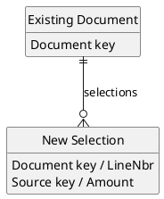
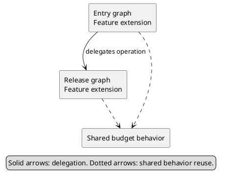
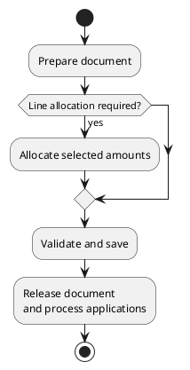

# Wiki Formatting and Diagrams

## Native Confluence content

Inspect the destination and reference page through the designated Wiki MCP. Request storage XHTML (`convert_to_markdown=false`) when editing macros or inline comments. A Markdown round trip can flatten code macros and lose comment anchors.

Use the live tool schema. Typical capabilities are `confluence_get_page`, `confluence_get_comments`, `confluence_update_page_section`, `confluence_update_page` and `confluence_get_page_diff`; their availability and policy may change.

### Code Block

Use the native `code` macro, with `sql` for SQL/DDL and `csharp` for C#. Full definitions should be collapsed so the design remains readable.

```xml
<ac:structured-macro ac:name="code" ac:schema-version="1">
  <ac:parameter ac:name="language">sql</ac:parameter>
  <ac:parameter ac:name="title">ExampleTable — complete SQL definition</ac:parameter>
  <ac:parameter ac:name="collapse">true</ac:parameter>
  <ac:plain-text-body><![CDATA[SQL source goes here]]></ac:plain-text-body>
</ac:structured-macro>
```

The body above illustrates serialization, not a table definition to publish. Insert actual source text. Use the same wrapper with `language=csharp` for DACs and selected members; title a shortened block as an excerpt or selected signatures.

Preserve source inside CDATA: C# XML comments, BQL generics, SQL operators and indentation are literal code. Split an embedded `]]>` as `]]]]><![CDATA[>` rather than corrupting the source or closing the macro body early. Preserve IDs on existing macros; new macro IDs may be unique generated values or assigned by Confluence.

### PlantUML

Confirm native PlantUML support from the reference/destination or an existing Wiki example. Use it to produce an editable graphic directly in the page when supported.

```xml
<ac:structured-macro ac:name="plantuml" ac:schema-version="1">
  <ac:parameter ac:name="title">Component dependencies</ac:parameter>
  <ac:parameter ac:name="atlassian-macro-output-type">INLINE</ac:parameter>
  <ac:plain-text-body><![CDATA[@startuml
rectangle "Entry graph" as Entry
rectangle "Shared behavior" as Shared
Entry ..> Shared
@enduml]]></ac:plain-text-body>
</ac:structured-macro>
```

Do not assume a plugin is installed merely because the MCP accepts storage XHTML. If native diagrams are unavailable, use an approved image-generation/rendering path and supported attachment transfer. A textual code diagram is not a substitute for requested graphics without agreement.

## Diagram selection and notation

| Diagram | Reader's question | Useful content |
| --- | --- | --- |
| Data relationships | What data is stored and how is it related? | New tables, important existing entities, keys/ownership and logical references |
| Component overview | Who owns each responsibility and what depends on what? | Host graphs, significant extensions, shared behavior and delegation |
| Main workflow | How does the feature's main processing path proceed? | Major operations, significant branches and handoffs |

Use only diagrams that add a distinct view. Keep overview nodes compact and move complete definitions to source blocks. Verify arrow direction/cardinality against code or the approved design; inheritance, delegation, selection transfer and a database reference are different relationships.

A data-model example, with illustrative names:



A component example:



An activity example:



Adapt the examples to verified feature behavior; they do not prescribe an Acumatica lifecycle. Each activity statement starts with `:` and ends with one terminator `;`. Use a literal `\n` inside a label for a line break; an extra `;` before it prematurely terminates the statement.

## Readable color defaults

Use color to distinguish categories and include a short legend. Preserve the user's established palette across revisions; a color-only request should change styling only.

| Role | Fill | Border | Text |
| --- | --- | --- | --- |
| New/shared elements | `#BFDBFE` | `#3B82F6` | `#17365D` |
| Existing elements | `#E5E7EB` | `#64748B` | `#111827` |

These are soft contrasting defaults, not a universal requirement. Avoid almost identical pale blue/grey fills and white text on a light blue background. Label categories so color is not the sole distinction.

For rectangles, a hidden styling stereotype scopes the colors:

```plantuml
skinparam rectangle {
  BackgroundColor #E5E7EB
  BorderColor #64748B
  FontColor #111827
  BackgroundColor<<Shared>> #BFDBFE
  BorderColor<<Shared>> #3B82F6
  FontColor<<Shared>> #17365D
}
hide stereotype
rectangle "Shared behavior" as Shared <<Shared>> #BFDBFE
```

For entity/class diagrams, also set the attribute/member font color:

```plantuml
skinparam class {
  FontColor #111827
  AttributeFontColor #111827
  BackgroundColor<<NewTable>> #BFDBFE
  BorderColor<<NewTable>> #3B82F6
  FontColor<<NewTable>> #17365D
  AttributeFontColor<<NewTable>> #17365D
}
hide stereotype
entity "New table" as NewTable <<NewTable>> #BFDBFE {
  Key fields
}
```

## Authorized publication and verification

1. Apply the authorization boundary in the main skill. Resolve the exact page, retrieve its current storage/version and relevant comments, and identify the bounded edit.
2. Prefer `confluence_update_page_section` for a uniquely named section. Its body excludes the target heading but includes nested lower-level headings/content. Preserve inline markers within the replaced section. Reconcile concurrent changes before saving.
3. Use whole-page replacement when the authorized edit genuinely spans the whole structure. Reread immediately before writing; do not assume an expected-version parameter exists.
4. Read back the saved storage and page diff; retrieve comments again. Compare the intended change scope, macro parameters and literal bodies. Unchanged comment counts alone do not prove that anchors survived.
5. For complete SQL/C# definitions, compare macro text against the source. Normalize XML entity serialization and intentional line endings rather than treating equivalent encoding or a generated macro ID as a content defect.
6. Verify diagram source and inspect rendering when an approved rendering path is available. Saved macro source alone does not prove visual output; report that limit accurately instead of claiming visual inspection.

### Attachments and tool limitations

Read the live upload schema and list existing attachments before choosing filenames. A same-named upload may create a new version of someone else's asset.

A remote upload tool's `file_path` can refer to the MCP server/container filesystem, not the user's machine. A Windows-local path can therefore fail even though the file exists locally. Inspect nested results: an outer success message may contain an inner `success=false` or file-not-found error.

Use a supported content/base64 transfer, an available shared path, or native diagrams as appropriate. Do not repeatedly retry the same inaccessible path or send private source/diagram data to a public rendering service without authorization. A server policy rejection is a stopping condition; use no alternate API/provider to bypass it.

## Review examples

When accessible and useful, these pages illustrate the agreed presentation:

- [AC-232646 technical specification](https://wiki.acumatica.com/pages/viewpage.action?pageId=283804460): concise responsibilities, source-linked inventory, collapsed full definitions, and three distinct native diagrams.
- [AC-377820 reference specification](https://wiki.acumatica.com/pages/viewpage.action?pageId=283804463): section order, header/navigation and native SQL/C# Code Block usage.

Retrieve them through `wiki-access` only when their current content is needed. They are examples of presentation, not requirements or sources of truth for another feature.
